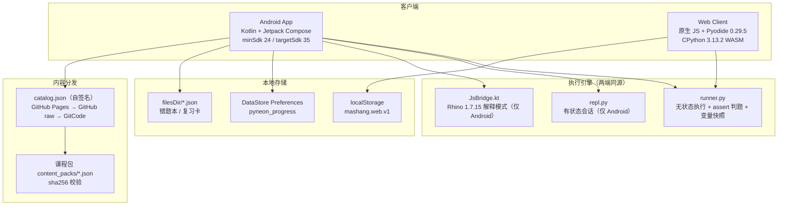

# 码上 · Mashang — Architecture

> 面向贡献者与二次开发者的实现说明。产品定位与下载入口见 [README.zh-CN.md](README.zh-CN.md)。
> 本文所有数字与文件路径均来自仓库当前代码；改动后请同步本节与 `tests/`。

## 1. 系统边界



设计约束：

- **判题语义单一实现**。`runner.py` 是唯一判题引擎；Android 通过 Chaquopy 调用，网页端通过 Pyodide 执行同一份源码（`web/gen_data.py` 内联，`tests/test_web_sync.py` 逐字节校验）。
- **运行时抽象**。`LanguageRuntime` 接口（`app/src/main/java/com/pyneon/academy/lang/LanguageRuntime.kt`）定义 `runCode / checkExercise / replStart / replPush / version / warmup / ensureStarted`；`PyBridge` 与 `JsBridge` 是两个实现，UI 只依赖接口与 `LanguageRegistry`。
- **离线优先**。学习、运行、判题不触网；只有「语言中心」手动检查/下载课程包时联网，走三级源 + SHA-256。

## 2. 执行与沙箱

### 2.1 Python（`app/src/main/python/runner.py`）

| 机制 | 实现 | 说明 |
|---|---|---|
| 隔离 | 每次运行新建 `namespace` | 运行间互不污染；判题测试跑在 `namespace.copy()` 上 |
| 超时 | `sys.settrace` 看门狗 + 工作线程 `join` | 纯 Python 死循环 8s 中断；C 阻塞调用（`time.sleep`）无法安全强杀，返回 Timeout 并放弃该线程（daemon） |
| 输出上限 | `MAX_OUTPUT = 1 MiB` | 超出保留尾部，避免 JSON 载荷爆内存 |
| 变量快照 | `_snapshot()` | 逆序取最近定义、跳过函数/模块/类，单值 repr 上限 200 字符，超大对象标 `<对象过大>` |
| 输入 | `_make_input()` 队列 | 运行台不等待真实 stdin；队列空即 `InputError` |
| 判题 | 有序用例共享 `test_ns` | 支持「准备 → 动作 → 断言」脚本式用例；**追加 `__stdout__` / `__stderr__`** 供输出断言 |
| 无多线程环境 | `Thread.start()` 抛 `RuntimeError` 时降级主线程 | Pyodide 无 SharedArrayBuffer 时的必要兜底 |

### 2.2 JavaScript（`app/src/main/java/com/pyneon/academy/js/JsBridge.kt`）

- Rhino 解释模式（`optimizationLevel = -1`，ART 上编译器产物不可用）。
- 看门狗用 `ContextFactory.observeInstructionCount` 等价 settrace。
- `ClassShutter { false }` 拒绝一切 Java 类访问（实测阻断 `Packages.java.lang.Runtime.getRuntime()`）。
- 结果契约与 `runner.py` 字段一致：`ok/stdout/stderr/error/duration_ms/variables/passed`。

### 2.3 结果契约

```json
{
  "ok": true,
  "passed": false,
  "stdout": "...",
  "stderr": "...",
  "test_output": "...",
  "error": {"type": "TestFailed", "message": "...", "traceback": ""},
  "duration_ms": 12,
  "variables": [{"name": "x", "type": "int", "value": "42"}]
}
```

## 3. 内容模型

`Lesson` / `Challenge`（`data/LessonRepository.kt`）字段：

| 字段 | 类型 | 约束 |
|---|---|---|
| `id` | string | 全局唯一（`tests/test_multilang_content.py` 校验跨语言唯一） |
| `chapter` / `chapterName` | int / string | 内置 38 讲分 5 幕（1-10 / 11-18 / 19-26 / 27-30 / 31-38） |
| `lang` | `python` \| `javascript` | 缺省 `python`，旧内容零改动兼容 |
| `blocks[]` | 14 种块 | heading/text/tip/warn/task/steps/diagram/output/table/code/quiz/order/practice/fill + exercise |
| `exercise.tests[]` | string[] | Python 为 assert 语句；JS 为 `assert(cond, msg)` |

内容包（`content_packs/*.json`）由语言中心下载到 `filesDir/courses/<id>.v<N>.json`；`catalog.json` 顶层 `sha256` 为「剥离自身 sha256 字段后的文本」哈希，包内 `sha256` 逐包校验。

## 4. 进度与数据

- `ProgressStore`（DataStore）保存 XP、通关集合、已解练习、连击、每日任务、徽章、活动日志。
- 毕业/首页进度只统计**内置主线**（`LessonRepository.mainline()`：`l01..l38`），下载的 DSA / JS 包不计入，避免「0/44」这类口径错误。
- 错题本与复习卡落 `filesDir/pyneon_mistakes.json` / `pyneon_review_cards.json`（`UserDataFiles` 单一事实源）。
- 复习调度为 SM-2 变体（`ReviewScheduler.kt`）：初次 1 天、第二次 6 天，之后 `interval × ease`；`again` 重置并 `lapses++`。
- 备份/恢复：`BackupUtil` 导出 JSON 到 Downloads（API 29+ 走 MediaStore），导入按版本号拒绝未来格式。

## 5. 导航与界面

- 单 Activity（`MainActivity`）+ Compose Navigation（`nav/AppNav.kt`），五 Tab：首页 / 课程 / 终端 / 挑战 / 我的。
- 次级路由：lesson、challenge、tracks、contenthub（兼容入口）、langcenter、backup、certificate、streak、review、history、settings、mistakes、privacy、help、about。
- `tests/test_ui_static.py::NavigationRouteTests` 扫描全仓 `navigate("x")`，任何未注册路由直接测试失败（历史 bug：`backup` 点击闪退）。
- 主题：`AppThemes` 7 套 + 自定义主色，`ThemePreference` 持久化，`MainActivity` 监听 SharedPreferences 即时切换。

## 6. 语言中心与发布链路

1. `catalog.json`（仓库根）登记包 id/version/description/sha256/kind/lang，自身用 `sha256` 字段签名。`kind` 固定为 `course`，`lang` 指明课程所属语言（python/javascript/lua/sql）。
2. `tools/sync_pages_assets.py` 把 catalog、`content_packs/`、`web/` 镜像到 `docs/`（GitHub Pages），并逐字节校验。
3. App 端 `ContentCenter.CATALOG_URLS` 三级回退：Pages → GitHub raw → GitCode API。
4. 下载校验：HTTPS 200、响应 ≤5MB、id 白名单 `^[a-zA-Z0-9_-]+$`、目标路径 canonical 越界检查、包 SHA-256。
5. 按需下载门禁：课程包未下载前不进入课程列表；包声明的 `lang` 无对应运行时则显示「缺运行时，暂不可下载」，不提供下载按钮。

## 7. CI / 发布

| 平台 | 触发 | 职责 |
|---|---|---|
| GitHub Actions（badhope 主仓） | push main / tag / PR / 手动 | Python 测试、内容校验、web 同源、lint、JVM 单测、debug+release 构建、APK 探针；tag 走签名发布 |
| GitHub Actions `mirror-sync` | main | 推送 GitCode / Gitee / 两个 GitHub 镜像仓 |
| GitCode Actions（手动触发，需仓库开通） | 手动 | 配置备份：引擎、内容、web 同源、APK 探针自测；未接 Pages 同步/链接检查，push 不自动触发 |

发布门禁（`scripts/ci/check_release_version.py`）：tag 必须等于 `versionName`，`versionCode` 必须大于上一 tag；签名证书主体必须为 `CN=Mashang`。

## 8. 测试布局

```
tests/
  test_engine_desktop.py      # 沙箱/超时/变量快照/无多线程降级
  test_engine_edge.py         # 边界与异常路径
  test_engine_coverage_gaps.py
  test_refactor_regression.py # 判题共享状态、快照顺序
  test_multilang_content.py   # lang 字段、运行时契约、UI 不得直接依赖 PyBridge
  test_sql_lessons.py         # SQL 课程包真执行（sqlite3）
  test_docs_claims.py         # 文档数字/能力声明/版本串与仓库事实一致
  test_js_lessons.py          # Node 真实执行 JS 课程与判题
  test_js_sandbox.py          # Rhino 静态契约
  test_web_sync.py            # web 与 App 同源 + 品牌资产指纹
  test_ui_static.py           # 导航路由、IME、主题键、讲数口径
  test_update_catalog.py      # catalog 签名与包哈希
  test_ci_workflows.py        # workflow 严格 YAML + 门禁在位
  test_apk_probe.py           # APK 探针自测（假绿防护）
  validate_content.py         # 55 Python 判题项 × 201 用例端到端（JS/Lua/SQL 由各自门禁执行）
```

## 9. 课程路线与更新检查

- **课程路线页**（`TrackRepository.kt`）只列真实内容：Python 主线 38 讲（`l01..l38`）、JavaScript / Lua / SQL 启程各 6 讲、DSA 基础/进阶各 5 讲、彩蛋 1 讲。未下载的包显示「可下载」并跳语言中心；没有任何硬编码的「开发中 x%」占位轨道。
- **进度口径**：`LessonRepository.mainline()` 用 id 正则 `^l\d{2}$` 取内置 38 讲，避免下载的 DSA 包把「x/38」变成「x/49」。
- **检查更新**（`utils/UpdateChecker.kt`）：只请求 GitHub Releases 的公开 latest 接口，语义化比较版本号；不自动下载、不申请安装权限。失败静默降级为「无法检查」，不影响离线学习。

## 10. 已知边界

- Chaquopy 仅支持 Android；iOS 需另选运行时。
- Rhino 为 ES5 + 部分 ES6，无 `async/await`、模板字符串等现代语法。
- 沙箱不是安全容器：网页端用户代码可访问 `js` 全局；Android 端 Rhino 已关闭 Java 互操作，Python 端未禁用 `import`（教学场景取舍，详见 `SECURITY.md`）。
- Web 端首屏需下载约 12 MB Pyodide WASM；离线后由浏览器缓存复用。
