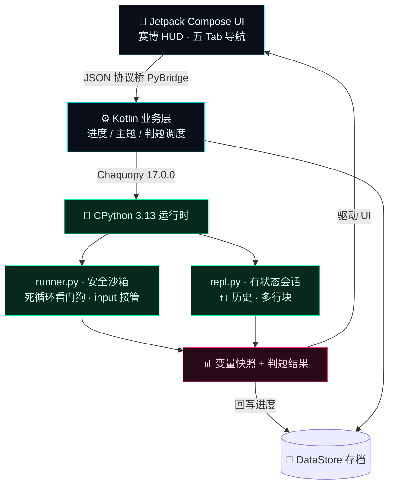
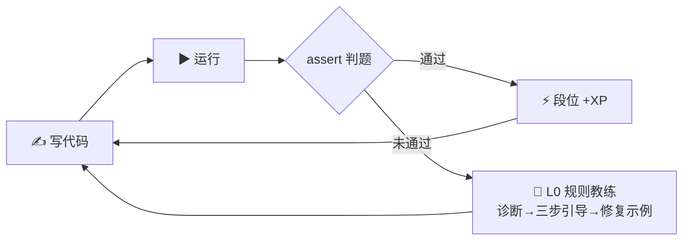
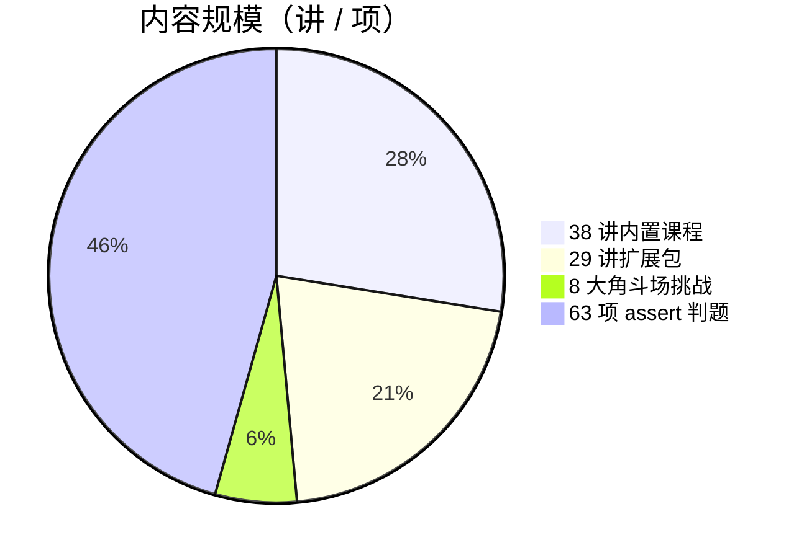

<div align="center">


**码上，就是马上。Learn Python instantly — on your phone, fully offline.**

一台装进口袋的赛博朋克编程学习终端：内嵌真实语言运行时（Python / JavaScript / Lua / SQL），
38 讲内置课程 + 29 讲扩展包、assert 自动判题、变量可视化、六段位成长体系。

[](https://github.com/badhope/mashang/actions)
[](LICENSE)
[]()
[]()
[]()
[](#-课程体系38-讲--五幕)
[](https://badhope.github.io/mashang/)

🌐 [English](README.md) | [中文](README.zh-CN.md) | [日本語](README.ja-JP.md)

[🎬 宣传片](#-宣传片50-秒入坑) · [⚡ 核心亮点](#-核心亮点30-秒速览) · [📊 它怎么离线](#-它怎么做到离线也能跑) · [📥 下载 APK](#-下载安装) · [课程体系](#-课程体系38-讲--五幕) · [⭐ Star](../../stargazers)

</div>

---

## 🎬 宣传片 · 50 秒入坑

<p align="center">
  <video src="demo/promo-video.mp4" poster="demo/promo-poster.jpg" controls width="380"></video>
  <br/>
  <a href="demo/promo-video.mp4"></a>
  <br/>
  <sub>▶ 点击海报观看 · <a href="demo/promo-video.mp4">直接打开视频</a>（MP4，1080×1920，约 50 秒，原创合成配乐）</sub>
</p>

> 🌐 [在线下载页](https://badhope.github.io/mashang/) —— 手机打开即看截图 / 视频 / 二维码下载，无需登录任何账号

## ⚡ 核心亮点 · 30 秒速览

| 你最关心的 | 一句话答案 |
|---|:--|
| **断网还能学吗？** | ✅ **真·全离线** —— CPython 3.13 整个嵌进 APK，地铁隧道里照样写码、跑码、判题升级 |
| **学完能算「会写」吗？** | ✅ **assert 自动判题** —— 测试用例不过就不放行，专治「看懂了但不会写」 |
| **有广告 / 要注册吗？** | ✅ **零广告 · 零账号 · 零数据上传**，MIT 开源，教师可放心推给学生 |
| **独门功能是什么？** | 🔬 **变量快照面板**（运行后整个命名空间可视化）· 六段位成长 · 每日任务 · 错题本间隔复习 |
| **课程量多大？** | 📚 **38 讲内置 + 29 讲扩展包（共 67 讲）**，Python 主线之外还有 JavaScript / Lua / SQL 各 6 讲，另附角斗场 8 大挑战 |

> 🎯 **一句话定位**：不是又一个「空白代码编辑器」，而是一台把 **CPython 解释器 + 判题引擎 + 游戏化成长** 全塞进手机的离线学习终端。

## 📊 它怎么做到离线也能跑

别人靠云端执行、断网即瘫；**码上** 把完整的 CPython 3.13 直接嵌进 APK，所有代码都在这台手机本地跑——下面这张图就是它的运行链路：



> 联网**只**在「内容中心」手动拉取课程包时发生（sha256 校验、不携带任何个人数据）。学习、写码、判题 100% 离线。

## 🔁 学习闭环 · 教会你为止

不是「看视频→忘了」，而是一套强制你动手的闭环：写完 → 跑 → 判题 → 不过就辅导 → 过了才升级。



## 📈 内容规模一览



## 🏆 六段位成长体系

像打游戏一样升级——从「脚本小子」一路打到「系统架构师」：


每升一段解锁新称号 + 霓虹成就墙，通关全部课程还会发**毕业证书**（霓虹认证页，截图即分享）。

## 📱 真机截图

全部来自真机模拟器（API 35，1080×2400）的实装构建，非设计稿。

| 指挥台 Home | 数据流 Lessons | 课程详情 Lesson |
|:--:|:--:|:--:|
|  |  |  |

| 练习编辑器 Editor | 解题步骤与输出 Steps | 角斗场 Arena |
|:--:|:--:|:--:|
|  |  |  |

| 终端 REPL（实跑） | JS 终端（Rhino） | 神经档案 Profile |
|:--:|:--:|:--:|
|  |  |  |

| 挑战详情 Challenge |
|:--:|
|  |

| 判题通过 | 判题失败 | 课程路线 |
|:--:|:--:|:--:|
|  |  |  |

| 内容中心 | 系统设置 | JS 课程 |
|:--:|:--:|:--:|
|  |  |  |

> 16 张截图全部来自 v0.4.0 实机（1080×2400，API 35 模拟器）：判题通过 +140 XP、失败面板给出 `TestFailed` 与首个失败用例、路线页只列真实内容、内容中心经 HTTPS 下载并做 SHA-256 校验。

> 以上全部是实装包的真实输出：`sorted(nums)` → `[1, 1, 2, 3, 4, 5, 6, 9]`，`sum(nums)/len(nums)` → `3.875`；JS 标签运行在 Rhino 1.7.15（`10 21`）；练习编辑器在填答案前真实报出 `NameError`；霓虹计数器为 150 XP 规格。

## 🎥 网页版演示 · 28 秒

<p align="center">
  <video src="demo/web-demo.mp4" poster="demo/web-demo-poster.jpg" controls width="640"></video>
  <br/>
  <a href="demo/web-demo.mp4"></a>
  <br/>
  <sub>▶ 真实网页端录制（1280×800，Chromium）：运行课程代码、通过判题、XP 落盘、REPL 交互。</sub>
</p>

## 🌐 网页版（浏览器）

第二个客户端用 Pyodide 0.29.5（CPython 3.13.2）在浏览器里跑**同一套课程 JSON 与同一份 `runner.py`**：

| 指挥台 | 课程与判题 | 终端 |
|:--:|:--:|:--:|
|  |  |  |

- 🔗 在线试玩：<https://badhope.github.io/mashang/web/>
- 🧵 执行在 Web Worker（15 秒硬超时，标签页不会冻结）；进度存 `localStorage`，hash 路由刷新不丢
- 🧩 范围：38 讲 Python 课程、6 道 Python 挑战、完整 REPL；2 道 JavaScript 挑战仅 App 内可跑


## 🎥 使用演示 · 100 秒上手实拍

<p align="center">
  <video src="demo/usage-video.mp4" poster="demo/app/home.png" controls width="380"></video>
  <br/>
  <a href="demo/usage-video.mp4"></a>
  <br/>
  <sub>▶ 点击画面观看 · <a href="demo/usage-video.mp4">直接打开视频</a>（MP4，720×1600，约 100 秒，实机录屏）</sub>
</p>

## 👤 适合谁

| 你是 | 你会得到 |
|---|---|
| 零基础学生 / 转行者 | 38 讲中文剧情课，从 print 一路打到装饰器 |
| 通勤碎片时间学习者 | 全离线，地铁隧道里也能跑代码 |
| 教师 / 家长 | 无广告、无账号、零数据上传，可放心推给学生 |
| 开发者 | Compose + Chaquopy 完整参考实现，MIT 开源 |

## 为什么是码上？

| | 别人的 | 码上 |
|---|---|---|
| 代码执行 | ☁️ 云端，断网即瘫 | 📱 **本机 CPython 3.13** |
| 教学风格 | 干瘪文档 | 赛博剧情 + 生活化比喻 + 随堂一问 |
| 运行反馈 | 黑框 print | **变量快照面板** + 结果直显 |
| 成长激励 | 打卡日历 | **XP / 六段位 / 每日任务 / 成就徽章墙** |

## ✨ 特性一览

### 🧠 学习闭环 —— 教会你为止

- ✅ **assert 自动判题** —— 通过测试用例才算过关，防止"看懂了但不会写"
- ✍️ **填空题 + 🧩 代码排序** —— 对标 Mimo 的低门槛题型：只敲缺失片段 / 把打乱的代码行排成正确程序
- 🧭 **L0 规则教练** —— 报错即辅导：离线规则引擎给出「诊断 → 三步引导 → 修复示例」，只提示不代写
- 📖 **错题本 + 间隔复习** —— 答错自动进错题本，按 SM-2 调度（1 天 → 6 天 → 按熟练度自适应增长）
- 🧭 **手把手引导** —— 每课标配：生活化比喻 → ASCII 图解 → TASK 跟改 → PRACTICE 跟练 → STEPS 思路卡

### 🔥 引擎硬核 —— 离线也能跑

- 🔌 **全离线 CPython 3.13** —— Chaquopy 内嵌真解释器；联网仅用于「内容中心」拉取课程包（sha256 校验，不携带任何个人数据）
- 🛡 **安全沙箱** —— 死循环看门狗强制中断、输入队列接管 `input()`、异常友好汉化
- 🎹 **代码编辑器** —— Python 语法霓虹高亮、智能缩进（`:` 自动进一层）、Tab 补空格
- 🖥 **神经接口 REPL** —— 有状态会话、↑↓ 历史、多行块、一键重置
- 🔬 **变量快照** —— 每次运行后展示命名空间里每个变量的名字/类型/值

### 🏆 成长激励 —— 像打游戏一样学

- 🏆 **六段位成长** —— 脚本小子 → 数据幽灵 → 网络浪人 → 义体黑客 → 街头传奇 → 系统架构师
- ⚡ **每日任务 / XP / 连击** —— 每天有目标，每次运行有反馈
- 📦 **内容中心** —— 课程包体系：彩蛋课·内置函数巡礼 + 增补包·DSA 算法基础/进阶 + 语言包·JavaScript / Lua / SQL 启程（共 29 讲），一键下载即学
- 🎓 **毕业证书** —— 通关全部课程解锁霓虹认证页，截图即分享

### 🧩 工程品质

- 🎨 **7 种颜色主题** —— 赛博霓虹 / 深空灰 / 极光绿 / 暮光紫 / 暮光橙 / 柔光护眼 / 白纸模式，切换即时生效无需重启
- 👓 **可读性优先** —— 特效只用在开屏/首页/终端等装饰区；课程正文与判题结果用无衬线大字直显，不搞花活
- ⚡ **离线优先** —— 课程与解释器全部内置，无需账号；新版本从 Releases 下载安装（应用内暂未内置自动更新）

## 📥 下载安装

> ⚡ **最快路径** → 🌐 [在线下载页](https://badhope.github.io/mashang/)：扫码或点链接，含宣传片、截图与安装引导。
> ⭐ **主仓库** → [github.com/badhope/mashang](https://github.com/badhope/mashang)（含 Pages 与 Releases 镜像）
> 🛰 **Pages 镜像** → [x33834.github.io/mashang](https://x33834.github.io/mashang/) · [morningstar202604.github.io/mashang](https://morningstar202604.github.io/mashang/)
> 📦 **仓库（并列同步，任选其一）** → [GitHub/badhope](https://github.com/badhope/mashang) · [GitHub/x33834](https://github.com/x33834/mashang) · [GitCode](https://gitcode.com/badhope/mashang) · [Gitee](https://gitee.com/badhope/mashang)

> Android 7.0+（minSdk 24），arm64-v8a 单架构（面向 64 位 ARM 真机）；release 构建已开启 R8 混淆压缩。

- ⭐ 推荐：从 [GitHub Releases](https://github.com/badhope/mashang/releases/latest) 下载最新 `mashang-*.apk`
- 开发者自行构建：

```bash
./gradlew :app:assembleDebug        # Debug 包
./gradlew :app:assembleRelease     # signed APK via KEYSTORE_PATH / KEYSTORE_PASSWORD / KEY_ALIAS / KEY_PASSWORD
python tests/test_engine_desktop.py   # 引擎单测
python tests/validate_content.py      # 课程×参考答案 全量校验
```

## ❓ FAQ

**Q: 真的完全离线？联网权限用来干嘛？**
学习、写码、判题 100% 离线。联网仅在「内容中心」手动检查/下载新课程包时发生，且不携带任何个人数据。

**Q: 和 Pydroid3 这类 IDE 有什么区别？**
Pydroid 是开发工具；我们是"课程即代码"的学习终端——每讲配判题实战与成长体系，目标是教会你，而不是给你一个空白编辑器。

**Q: 会出 iOS 版吗？**
技术栈（Chaquopy）仅支持 Android；iOS 需另选型，在 Roadmap 远期观察中。

**Q: 课程内容可以商用吗？**
可以。项目以 **MIT 协议** 开源——允许自由使用、修改、分发（含商用），只需保留许可声明。完整条款见 [LICENSE](LICENSE)。

## 📚 课程体系（38 讲 · 五幕）

<details open>
<summary><b>第一幕 · 基础协议</b>（点击折叠）</summary>

`01 第一次握手` · `02 变量与数据类型` · `03 字符串行动` · `04 数字运算协议` · `05 输入信号` · `06 条件分支矩阵` · `07 循环引擎` · `08 列表仓库` · `09 字典密钥库` · `10 基础篇毕业式`

</details>

<details>
<summary><b>第二幕 · 进阶装备</b></summary>

`11 字符串百宝箱` · `12 元组与集合` · `13 函数进化论(*args/**kwargs)` · `14 推导式风暴` · `15 异常护盾` · `16 数据持久化(文件/JSON)` · `17 模块召唤术` · `18 类与对象觉醒`

</details>

<details>
<summary><b>第三幕 · 高阶义体</b></summary>

`19 继承与魔法方法` · `20 综合项目·赛博银行` · `21 生成器引擎` · `22 装饰器战衣` · `23 lambda三剑客` · `24 标准库实战(Counter/re)` · `25 时间与随机宇宙` · `26 毕业项目·日志分析器`

</details>

<details>
<summary><b>第四幕 · 边界之外</b></summary>

`27 资源管家with` · `28 文件读写协议` · `29 自定义异常` · `30 模块与主守卫(__main__)`

</details>

<details>
<summary><b>第五幕 · 生产实战</b></summary>

`31 正则表达式` · `32 类型提示与数据类` · `33 函数式工具箱` · `34 并发初探` · `35 异步协程` · `36 命令行工具箱` · `37 调试与测试` · `38 虚拟环境与工程化`

</details>

<details>
<summary><b>语言扩展包 · 内容中心下载</b></summary>

彩蛋课·内置函数巡礼（1 讲）· 增补包·DSA 算法基础（5 讲）· 增补包·DSA 算法进阶（5 讲）· 语言包·JavaScript 启程（6 讲）· 语言包·Lua 启程（6 讲）· 语言包·SQL 启程（6 讲）

</details>

每讲均含：**可运行示例 + OUTPUT 结果预览 + 图示/表格 + QUIZ 随堂一问 + assert 判题实战**
另有角斗场 8 大挑战：霓虹计数器 / 回文侦测器 / 密码强度防火墙 / 括号防火墙 / 游程压缩器 / 库存管家，以及 JS 版霓虹计数器与括号防火墙。

## 🧱 技术架构

```
Kotlin + Jetpack Compose (Material3 赛博定制主题)
        │  LanguageRuntime 统一契约（JSON 载荷）
PyBridge(Chaquopy) ──► CPython 3.13 (runner.py / repl.py)
JsBridge(Rhino)    ──► JavaScript（语言包课程经内容中心下载）
LuaBridge(LuaJ)    ──► Lua（沙箱：无 io/os/require）
SqlBridge(sqlite3) ──► SQL（内存库，ATTACH 被拒）
DataStore 进度存档 │ Navigation 单Activity五Tab │ 自研语法高亮器
```

更直观的运行链路见上方 [「它怎么做到离线也能跑」](#-它怎么做到离线也能跑) 的架构图。

## 🗺 Roadmap

- [x] v0.1 MVP：引擎闭环 + 7 界面 + 判题
- [x] v0.2 内容大爆炸：26 讲 + 4 种新内容块（表格/图示/随堂问/输出预览）
- [x] v0.2.1 内容中心：在线课程包下载（端云协同），首发包「内置函数巡礼」
- [x] v0.3 阶段成果：DSA 增补包 ×2（10 讲）、L0 离线规则教练、错题本 + 间隔复习、UI 可读性整改（特效收敛、正文无衬线放大）
- [ ] v0.3 剩余计划：turtle 海龟画布 · matplotlib 图表输出 · 执行过程变量动画
- [x] v0.4.0：LanguageRuntime 抽象 + JavaScript 语言包（Rhino）+ 语言过滤/切换 UI · 网页版（Pyodide 0.29.5，同一引擎）· 应用内检查更新 · 真实课程路线页
- [ ] v0.5：turtle 海龟画布 · matplotlib 图表输出 · 平板适配 · QuickJS 后端（ES6+）
- [ ] v1.0 应用商店全渠道上架

## 🧪 测试与质量门禁

| 门禁 | 命令 | 证明什么 |
|---|---|---|
| Python 引擎 + 内容 | `python -m unittest discover -s tests` | 149 条桌面测试：沙箱、超时、判题、内容结构、文档口径 |
| 课程 × 参考答案 | `python tests/validate_content.py` | 55 个 Python 判题项、201 条用例端到端跑通 |
| JS 课程 | `python -m unittest discover -s tests -k test_js_lessons` | 每个 JS 代码块与练习用 Node 真实执行 |
| 网页/App 同源 | `python -m unittest discover -s tests -k test_web_sync` | `data.js` / `engine.js` 可重现、逐字节一致 |
| Android lint + 单测 | `./gradlew :app:lintDebug :app:testDebugUnitTest` | 0 lint error，JVM 单测（版本比较、文件 IO） |
| APK 探针 | `python tests/ci_apk_probe.py <apk>` | APK 内 runner.py、assets、JS 语法、清单完整 |
| Pages 资产 | `python tools/sync_pages_assets.py` | 目录 / 课程包 / 网页端副本逐字节一致 |

## 🤝 参与贡献

欢迎一切形式：新课程内容、Bug 反馈、UI 打磨、多语言翻译。
Fork → 新建分支 → 提交 PR；课程内容请同步更新 `tests/validate_content.py` 的参考答案并保证全部 PASS。

## 📄 许可与隐私

本仓库以 **MIT 协议** 开源：允许自由使用、修改、分发（个人、教育或商业用途均可），只需保留许可声明。

- ✅ 可查看、学习、修改、再分发，也可基于此构建商业产品。
- ✅ 按「原样」提供，不附带任何担保，风险自负。
- ™ "码上" / "Mashang" 名称与标识为保留商标。

第三方组件：[Chaquopy](https://github.com/chaquo/chaquopy) (MIT)、Jetpack Compose (Apache-2.0)、[Rhino](https://github.com/mozilla/rhino) (MPL-2.0)、[sora-editor](https://github.com/Rosemoe/sora-editor) (LGPL-2.1)。

**CI/CD**：[GitHub Actions](https://github.com/badhope/mashang/actions)（测试 + lint + debug/release 构建 + APK 探针 + 签名发布，三仓镜像同步）是唯一实际执行并强制门禁的流水线。`.gitcode/workflows/ci.yml` 只是等价门禁的配置备份：GitCode 的代码化流水线需仓库手动开通，push 不会自动触发（2026-10-24 实测运行记录全部为手动触发，且未包含 Pages 同步/链接检查两步）。

📄 [隐私政策](PRIVACY_POLICY.md) · [用户协议](TERMS_OF_SERVICE.md)
